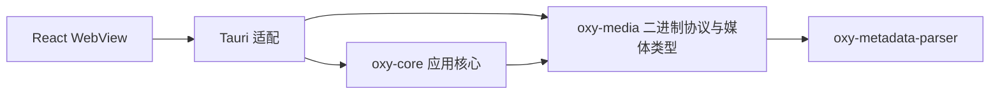

# OxyViewer 架构

OxyViewer 按一个应用核心和少数独立技术库组织。当前 Rust workspace 有四个 package；
应用功能在 `oxy-core` 内按状态、规则和用例归属划分模块。媒体和解析器保留独立构建边界。
最后核对：2026-10-14。重构实现与验收状态见[实施清单](tasks/core-layout-refactor.md)。

## 依赖和运行边界

桌面适配 commands、类型化事件、二进制协议和窗口能力；应用规则、事务、排队、缓存
协调及后台任务归 core。Core 不依赖 Tauri。Media 不依赖 SQLite、人物或桌面，parser
不依赖其他 workspace package。没有旧包名的 forwarding 层。

前端通过 command 交换小型结构化数据，通过 event 镜像已提交状态，通过自定义协议
读取媒体内容。图片字节不经 JSON IPC。资源状态继续遵循
[ADR 0008](adr/0008-rust-owned-resource-projections.md)：Rust 是带版本投影的权威拥有方。

## 应用模块

| 归属 | 职责和入口 |
| --- | --- |
| core::app | OxyApp 装配、路径、命名跨功能 workflows |
| core::runtime / jobs | worker 准入、停止、事件、优先级与 foreground gate |
| core::browse | BrowseService、分页、条件组合、目录快照、目录树调度 |
| core::files | 路径/会话安全、文件发现、FileService 与操作恢复 |
| core::library | LibraryService、用户根目录、索引政策和调度 |
| core::tags | 词汇、层级、独立赋值来源、持久 XMP 镜像 |
| core::people | PersonService、全局身份/tuple/审阅/参考、派生分析与模型环境 |
| core::metadata | MetadataService、应用元数据解释、sidecar 编辑、提供者任务 |
| core::resources | ResourceService、预览/metadata 队列、投影、缓存协调与诊断 |
| core::storage | 私有 SQLite/WAL、表声明机制、schema 注册与版本检查 |
| media | 源事实、原生标签、表示选择、解码、像素、产物、资源 registry/lease |
| parser | 独立 EXIF/XMP/IPTC/ICC/MakerNote 和容器解析 |

简单功能不需要机械地创建 types/service/repo/schema 四个文件。用例入口必须能完整阅读；
避免巨型 App、通用 cross repository 或为了一个函数再加转发层。

## 装配与退出

`OxyApp::open(AppPaths)` 打开一个 Store，装配共享功能服务与资源状态。Tauri setup
只取得平台路径、接入事件和注册窗口。Headless 宿主使用相同 core 服务。

CoreRuntime 登记分析、文件、编辑、提供者和队列 worker。停止拒绝新工作/事件、取消
协作任务、释放等待者、唤醒 gates，并等待退出；目录快照另有明确排空/join 机制。
已经进入不可中断 native 调用的工作自行展开，截止时间到达返回超时，不假称退出。
详见[核心归属与生命周期](architecture/11-core-ownership.md)。

## 持久化与事务

单个 SQLite 文件便于跨功能动作共同提交。每个功能拥有自己的 repo 和 schema；storage
只管理共享机制。Repo 不开启事务、不决定规则。人物审阅/标框/标签、文件动作和根恢复
由具名 workflow 确定跨功能事务范围，再调用拥有方的操作。

每张表声明 `user/cache/marker` 分类。姓名、人工框、决定、参考、历史、标签、根目录和
恢复记录属于用户事实；检测、向量、建议、索引、快照和投影可重建。清缓存与重新分析
不能删除用户事实。产品预览清理仍只处理当前预览文件。

数据与缓存隔离在 `core-v2`，当前 SQLite schema 为 2。旧/未知/未来的非空库在 writer
打开前只读拒绝，不升级、不删库、不 checkpoint。当前格式的未来升级必须明确保护用户
声明。[schema 切换记录](tasks/core-schema-retirement.md)说明这次不兼容边界。

文件系统和 SQLite 无法共同原子提交。FileService 先检查路径/sidecar，再逐文件记录
prepared/filesApplied 与版本证明；资料提交失败保留恢复记录，证明不匹配要求检查，
不会自动重复文件动作。根恢复重绑经过来源证明的事实，未匹配事实保留并标记需核对。

## 主要用户路径

打开目录返回廉价、非递归、分页的摘要，索引/元数据/预览延后执行。BrowseService
组合标签、metadata 和当前人物 tuple 条件后分页；多个人物实例不会重复一张照片。
普通浏览不加载模型、不等待递归索引或解码。

PersonService 使用全局身份；文件夹人物组是 tuple 的投影。机器建议不自动建立人工
归属。审阅、排除、参考和 revision 独立；几何修改撤回失效参考与人物贡献，保留手工
来源。跨功能事务包含幂等 payload/result 和持久镜像任务，提交后才唤醒 TagXmpSync。

ResourceService 在 blocking 派发前捕获 full selection，拥有预览范围、缓存/产物/
原生会话选择、事件和失效。Media 执行受控解码，维护 native gates、产物 generation、
registry 与 lease。取消、同源合并、提级保留等待者和迟到结果拒绝继续有效。

元数据原生读取和归一化归 media；应用解释、同名 XMP 优先级和编辑归 core。部分批量
写入成功后仍刷新已写文件。ExifTool 配置/安装/观察和人物模型任务有 core worker 归属。

## 契约和扩展

对外 serde 类型定义在真实拥有方，应用类型由 contracts 显式导出。固定版本 ts-rs
生成 TypeScript；`pnpm contracts:check` 检查漂移。Frontend API 和 browser demo 维护
同一命令语义，界面派生模型继续在前端定义。

新增标签规则通常修改 tags 和其测试；人物算法修改 people；格式/解码修改 media/parser。
新增契约才扩展 exporter 和桌面适配。模块可见性、命名工作流、行为测试与源码审计替代
旧应用 crate 之间的包依赖限制。[扩展指南](architecture/06-extension-guide.md)列出步骤。

## 专题与验收

- [浏览与分页](architecture/02-folder-browsing.md)
- [预览管线](architecture/03-preview-pipeline.md)、[HEIF 会话](architecture/04-heif-tile-session.md)
- [数据与安全](architecture/05-data-and-state.md)、[人物工作流](PERSON_WORKFLOW.md)
- [性能不变量](PERFORMANCE_INVARIANTS.md)、[预算](PERFORMANCE.md)、[正式 E2E](PERF_E2E.md)
- [专题索引](architecture/README.md)、[构建与检查](../CONTRIBUTING.md)

行为测试、正式 WebView/真实媒体比较和增量构建测量分别提供不同证据；本地 Windows
通过不能代表其他平台已验证。当前具体结果与剩余门槛以实施清单和 dated research 为准。
