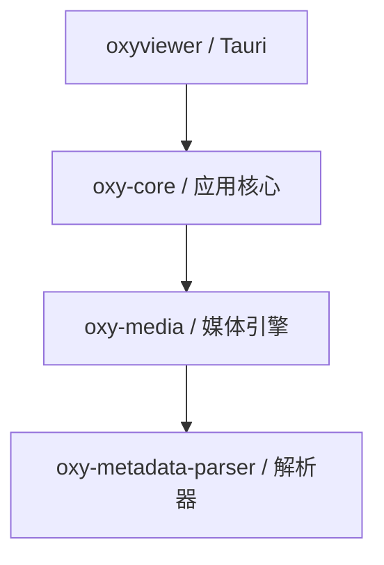

# OxyViewer 代码组织重构报告

日期：2026-10-13。状态：架构建议，尚未实施。

本报告按“不考虑旧 API、旧数据库和历史实现兼容”的前提设计目标结构。当前功能的正确性、安全性和交互要求仍作为设计输入。旧包名、旧调用路径、旧 schema 和既有拆分计划不作为必须保留的约束。

## 1. 建议结论

**建议将当前 11 个 Rust package 收敛为 4 个：桌面适配层、应用核心、媒体引擎、元数据解析器。应用功能用模块组织，crate 用来隔离真正不同的依赖、构建和复用边界。**

```text
apps/desktop/src-tauri/       oxyviewer：Tauri、窗口、IPC、事件和协议适配
crates/oxy-core/             浏览、资料库、人物、标签、元数据编辑、任务和存储
crates/oxy-media/            解码、媒体读取、像素处理、artifact 和资源生命周期
crates/oxy-metadata-parser/  独立的容器与元数据解析器
```

这会取消 `oxy-domain`、`oxy-fs`、`oxy-library`、`oxy-metadata`、`oxy-people`、`oxy-runtime`、`oxy-store`、`oxy-tags` 的独立包身份，将其职责重新归入模块。不是把八个旧 crate 原封不动塞入一个新目录：类型归属、用例编排、SQL 位置和运行时所有权一起调整。

最重要的三项变化：

1. **应用核心成为真正的应用层。** 浏览筛选、人物确认与标签贡献、文件移动后的状态更新，都有明确的用例入口；Tauri 不再组装这些流程。
2. **类型随能力归属。** 媒体类型属于媒体引擎，人物类型属于人物模块，IPC 表达属于应用契约；取消所有下层都依赖的类型总仓库。
3. **业务与自己的持久化代码邻近。** 标签的规则、类型、SQL 和测试在标签模块内；共享存储模块只管理连接、事务机制、schema 生命周期和清理能力。

## 2. 调研范围和证据口径

OxyViewer 基于当前工作区读取，HEAD 为 `420d2076e1ff98e639139e1f04b7c3fa2ab7d58b`。工作区已有前端与文档修改，本报告没有改动这些文件。

bili-sync 读取了公开仓库的实际源码，固定参考提交为 [`c900777e78796653fdfb00421879b6a802d1eedd`](https://github.com/amtoaer/bili-sync/tree/c900777e78796653fdfb00421879b6a802d1eedd)，该提交时间为 2026-09-10。参考内容包括 workspace、包依赖、启动入口、工作流、来源适配器、API 路由、数据库初始化、实体和迁移。

数量通过 `cargo metadata --no-deps --format-version 1 --offline` 和 `src/**/*.rs` 文件统计取得。以下行数是**物理行数，包含空行、注释、内联测试及数据表**，不表示生产代码复杂度，也不包含原生第三方源码、build.rs、examples 和独立 tests 目录。本次没有执行应用、构建或性能基准；编译速度和运行速度均不作实测结论。

## 3. bili-sync 值得参考的组织方式

### 3.1 大部分应用行为留在主 crate 内

其 workspace 只有三个包：

| 包 | 源文件数 | 物理行数 | 职责 |
| --- | ---: | ---: | --- |
| `bili_sync` | 74 | 11,435 | 应用、API、任务、下载、来源适配、配置和业务工作流 |
| `bili_sync_entity` | 14 | 446 | SeaORM 实体及自定义字段类型 |
| `bili_sync_migration` | 15 | 1,186 | 数据库版本迁移 |

主 crate 使用 `adapter`、`api`、`bilibili`、`config`、`database`、`downloader`、`notifier`、`task`、`workflow` 等模块组织能力。API、任务和业务没有各自成为 crate。见 [workspace](https://github.com/amtoaer/bili-sync/blob/c900777e78796653fdfb00421879b6a802d1eedd/Cargo.toml) 与 [启动入口](https://github.com/amtoaer/bili-sync/blob/c900777e78796653fdfb00421879b6a802d1eedd/crates/bili_sync/src/main.rs)。

可借鉴的是：**功能目录不自动等于发布、依赖和公共 API 边界。**

### 3.2 流程有可阅读的集中入口

`workflow::process_video_source` 顺序表达来源刷新、简要信息入库、详情取得、下载和通知。不同视频来源通过 `VideoSource` 适配到同一流程。见 [workflow.rs](https://github.com/amtoaer/bili-sync/blob/c900777e78796653fdfb00421879b6a802d1eedd/crates/bili_sync/src/workflow.rs) 与 [来源接口](https://github.com/amtoaer/bili-sync/blob/c900777e78796653fdfb00421879b6a802d1eedd/crates/bili_sync/src/adapter/mod.rs)。

对 OxyViewer 的启发：应该能从一个入口读懂“确认人物会产生什么”“移动照片会更新什么”，而不是先理解若干 crate 之间为什么不能相互调用。

### 3.3 启动、接口和后台任务分工明确

`main` 负责初始化和任务生命周期；API 内按路由分模块；后台服务在 `task` 内组织。数据库连接初始化留在主 crate 的 `database.rs`，迁移单独成包。这并不是“所有存储都必须另起一个 crate”的做法。见 [数据库初始化](https://github.com/amtoaer/bili-sync/blob/c900777e78796653fdfb00421879b6a802d1eedd/crates/bili_sync/src/database.rs) 与 [路由组织](https://github.com/amtoaer/bili-sync/blob/c900777e78796653fdfb00421879b6a802d1eedd/crates/bili_sync/src/api/routes/mod.rs)。

### 3.4 不应照搬的部分

- OxyViewer 有原生解码、像素处理、媒体租约和交互优先级；这些构建和生命周期边界值得单独保留，不能直接压成 bili-sync 式的单一主业务包。
- OxyViewer 当前使用 rusqlite，没有必要为模仿目录结构引入 SeaORM，也不需要专门的 entity 和 migration crate。
- bili-sync 的 `workflow.rs` 为 946 行，`utils` 内也包含模型与状态行为。模块化仍需要进一步按用例收敛；少 crate 本身不保证职责清晰。
- 两个项目规模和负载不同。这里借鉴组织原则，不据此断言 bili-sync 的并发或数据库配置适合照片浏览器。

## 4. OxyViewer 当前问题的具体位置

### 4.1 包边界多，但功能修改仍横跨多个位置

| 当前包 | 源文件数 | 物理行数 | 判断 |
| --- | ---: | ---: | --- |
| `oxyviewer` / Tauri | 27 | 8,884 | 适配层承载了大量应用编排与队列实现 |
| `oxy-domain` | 10 | 2,405 | 既有 IPC DTO，也有媒体事实、几何、调度和人物词汇 |
| `oxy-fs` | 4 | 2,759 | 应用专属的目录会话、发现、安全文件操作，适合核心模块 |
| `oxy-library` | 9 | 4,540 | 收藏根、索引、目录快照和投影，应用相关性强 |
| `oxy-media` | 65 | 24,380 | 原生依赖、优化配置和媒体生命周期构成有效边界 |
| `oxy-metadata` | 10 | 3,779 | 读取归一化与编辑、sidecar、连拍等应用职责混合 |
| `oxy-metadata-parser` | 26 | 35,740 | 独立纯 Rust 解析器；其中 MakerNote 文件约 20,339 行 |
| `oxy-people` | 35 | 11,336 | 人工事实、查询和推理已集中，但编排仍分布在桌面层 |
| `oxy-runtime` | 2 | 872 | 实际包含照片应用的工作数与优先级控制，并非完整独立运行时 |
| `oxy-store` | 15 | 4,992 | 机制、所有 feature 的 SQL、跨域协调集中于同一包 |
| `oxy-tags` | 2 | 1,150 | 主要是一个实现文件；包隔离的收益来自依赖限制，独立复用证据不足 |

现有边界保护了一些重要方向，但为了共享一句规则或一个数据结构，需要新增公共类型、公共 repo 函数和跨包转换。它更像把单体应用的内部模块都提升成了公共库。

### 4.2 “薄 Tauri 层”与实际结构不一致

`jobs.rs` 和 `jobs/` 合计 4,087 行，`state/cache.rs` 为 463 行；两者已经超过 Tauri 包物理行数的一半。仅 `jobs/preview.rs` 就有 2,887 行，其中第 1,891 行才进入测试模块。它拥有 request key、同源合并、等待者、取消、调度 scope、投影恢复和失效语义。

`commands/folder.rs::list_assets` 同时协调 files、metadata、library、tags、people，再进行筛选和分页。`commands/people_analysis.rs` 还包含运行预留、模型状态组合、下载和分析启动流程。

因此，仅把小 crate 合并，却继续把用例和调度留在 Tauri 内，无法解决主要的组织问题。源码入口：`apps/desktop/src-tauri/src/jobs/preview.rs`（基线 `595a46b`）、[`commands/folder.rs`](../../apps/desktop/src-tauri/src/commands/folder.rs)、[`commands/people_analysis.rs`](../../apps/desktop/src-tauri/src/commands/people_analysis.rs)。

### 4.3 共享类型包放在依赖图最底部，影响面过大

当前 9 个包直接依赖 `oxy-domain`。其内容从 `FolderSession`、`CustomTag` 延伸到 `ArtifactFacts`、`ImageOperation`、`PixelDimensions` 和调度诊断。

这些类型并非同一种契约。人物功能改动不应成为媒体引擎的类型依赖；媒体内部的完整性事实也不必为了“共享”被放到应用 DTO 的公共包里。广泛共享还增加变更的下游影响面，但实际增量编译代价需要测量，不能只由依赖图推出。

### 4.4 业务的规则和 SQL 相距较远，跨功能编排位置不自然

标签和人物政策在各自 crate，SQL 在 `oxy-store::repo`；跨功能行为落到 `repo/cross.rs`。例如人物确认是否贡献标签、同目录与跨目录移动后的不同处理，阅读时必须来回切换业务与集中存储层。

当前契约明确允许这些跨域存储操作，这不是把现状判为违规。问题是：当领域被强制设为互不依赖的兄弟 crate 后，应用真实需要的协作只能绕到存储层或 Tauri 层。新设计应直接给这种协作一个应用用例层。见 `crates/oxy-store/src/repo/cross.rs`（基线 `595a46b`）。

### 4.5 继续既有拆分计划，会延续当前组织成本

现有计划记载 A–D 已完成，E、P 未开始；P 还计划新增 `oxy-preview`。本报告同意应把 preview 队列移出 Tauri，但建议移入 `oxy-core::resources`，不新增 package。E 所表达的 SQL 分层需求则改由 feature 内的 repository 模块解决。

这两项应在选定新架构后重新规划，不能同时沿着相反方向实施。见 [`store-repository-split-plan.md`](../archive/plans/store-repository-split-plan.md)。

## 5. 目标依赖图

箭头表示“依赖”，不是运行时消息方向：



默认桌面包只依赖 `oxy-core`，通过核心的类型化资源读取接口完成协议适配。若某项原生协议集成确实需要直接访问媒体引擎，可增加 `desktop → media`；这是一条有具体理由的边，不把媒体业务重新放回桌面包。

- core 不依赖 Tauri，不持有 `AppHandle`、窗口或 WebView。
- media 不依赖 core、SQLite、人物规则或应用级调度 scope。
- parser 不依赖其他 OxyViewer 包，不启动子进程，不写 sidecar。
- 不引入新的 `common`、`shared`、`domain` 或 `runtime` 包承担循环依赖。

## 6. 建议目录结构

使用现有 Rust 风格：模块入口为 `foo.rs`，子模块放在 `foo/`，不采用 `foo/mod.rs`。

```text
apps/desktop/
  src/                              React；本轮组织重构不必同时大改 UI
  src-tauri/src/
    main.rs                         可执行入口
    lib.rs                          Tauri 启动、插件、命令与协议注册
    bootstrap.rs                    解析 app/resource/cache 目录，构造核心
    commands.rs
    commands/                       按功能组织的薄 IPC 适配
    events.rs                       CoreEvent 到 Tauri event 的映射
    protocol.rs                     URL/HTTP 到核心资源读取的映射
    platform.rs                     窗口、系统对话框等桌面适配

crates/oxy-core/src/
  lib.rs                            少量公共导出
  app.rs                            OxyApp、配置、服务装配与关闭
  app/
    workflows.rs
    workflows/
      person_tags.rs                人物确认与标签贡献的原子用例
      asset_move.rs                 文件移动及资料状态更新
      asset_delete.rs               明确删除后的应用状态处理
  browse.rs
  browse/
    types.rs                        会话、查询、分页输出
    snapshots.rs                    当前目录快照、排序和分页
    query.rs                        标签/人物/元数据条件组合
    service.rs                      open/list/refresh 用例
    repo.rs                         浏览缓存持久化
  files.rs
  files/
    paths.rs                        路径身份、安全范围和源观察
    scan.rs                         廉价非递归发现
    operations.rs                   安全移动、复制、回收站等机制
    external_apps.rs                外部应用发现与启动
  library.rs
  library/
    roots.rs                        用户资料库根
    index.rs                        延后索引任务
    repo.rs
    schema.rs
  tags.rs
  tags/
    types.rs
    service.rs                      层级、赋值来源和有效标签规则
    repo.rs
    schema.rs
    xmp_sync.rs                     持久的 sidecar 同步任务
  people.rs
  people/
    types.rs
    identity.rs                     全局身份、参考
    review.rs                       人工实例、审阅、历史
    query.rs                        人物聚合与检索投影
    clustering.rs
    analysis.rs                     检测/编码/发布工作流
    analysis/                       ledger、worker、输入与发布
    inference.rs
    inference/                      ORT、DirectML、CoreML 等具体适配
    models.rs                       模型目录、校验、下载与安装
    repo.rs
    repo/                           按人工事实、检测、特征等继续分文件
    schema.rs
  metadata.rs
  metadata/
    types.rs                        应用详情及编辑契约
    service.rs                      sidecar-first 详情和编辑用例
    write.rs                        字段 patch、原子写入和失效
    burst.rs                        连拍等应用解释
  resources.rs
  resources/
    images.rs                       image 请求合并、projection 和发布
    metadata.rs                     metadata 请求与 projection
    directory_tree.rs
    intents.rs                      scope、tier/rank、可见性和 selection
    repo.rs                         可重建的持久化 projection
    schema.rs
  jobs.rs
  jobs/                             通用任务登记、状态、关闭和资源预算
  storage.rs
  storage/
    connections.rs                  SQLite/WAL、reader 与 writer
    transaction.rs                  事务机制；不决定业务步骤
    schema.rs                       schema 注册、版本和升级执行
    tables.rs                       user/cache/marker 声明机制
    cache.rs                        只接收 cache 表的清理能力
    vector.rs                       sqlite-vec 注册与机制适配
  contracts.rs                      对外请求、输出、事件和稳定错误码入口
  settings.rs

crates/oxy-media/src/
  lib.rs
  types.rs                          SourceRevision、尺寸、媒体事实、描述符
  control.rs                        解码取消和底层工作控制
  source.rs                         容器探测、嵌入预览、尺寸和方向
  decode.rs
  decode/                           按格式/原生 backend 组织
  metadata.rs                       原生读取、归一化和可选 ExifTool 读取适配
  pixels.rs                         色彩、重采样和分析输入
  pipeline.rs                       媒体请求到产物的流水线
  cache.rs                          artifact manifest、生产锁和磁盘维护
  publication.rs                    registry、lease、提交和二进制读取
  presentation.rs                   完整图/渐进瓦片的呈现机制

crates/oxy-metadata-parser/src/       保留独立的解析器组织
```

上面是职责地图，不要求每个模块机械地拥有同样的 `types/service/repo/schema` 四个文件。简单模块先用一个文件；根据实际阅读难度和测试边界再拆。尤其不应把一个函数包装成一个 service 文件。

## 7. 八个旧 crate 的具体去向

| 旧职责 | 新归属 | 要做的调整 |
| --- | --- | --- |
| `oxy-domain` 的应用请求、输出和事件 | `core::<feature>::types`，由 `contracts` 导出 | 不再承载媒体内部词汇；内部模型与 IPC DTO 必要时区分 |
| `oxy-domain` 的尺寸、媒体事实、资源描述 | `media::types` | 由下层自己拥有，上层依赖或转换 |
| `oxy-fs` | `core::files` + `core::browse` | 路径/操作安全与目录快照/查询分工 |
| `oxy-library` | `core::library`、`browse`、`resources` | 不再成为所有派生应用状态的集合 |
| `oxy-metadata` | `media::metadata` + `core::metadata` | 读容器、读 native 标签归媒体；字段编辑和应用解释归核心 |
| `oxy-people` | `core::people` | 人工事实、推理建议、模型环境继续分模块；工作流一起搬入 |
| `oxy-runtime` | `core::jobs/resources` + `media::control` | 应用调度放上层，解码所需取消控制放下层，避免反向依赖 |
| `oxy-store` | `core::storage` + 各 feature 的 `repo/schema` | 移除集中 SQL 公共库；连接和表清理机制继续统一 |
| `oxy-tags` | `core::tags` | 规则和自己的 repo 邻近；跨功能用例进入 `app::workflows` |
| Tauri `jobs/*`、缓存编排、分析编排 | `core::resources/jobs/people` | 移除 `AppHandle`；发布类型化事件，桌面层负责转发 |

media 不再依赖应用的 files 模块。核心先校验目录会话与路径范围，再传入媒体引擎拥有的源描述和版本；媒体内部读取源文件、维护 artifact 的 I/O 留在引擎内。文件发现和用户文件变更仍统一经过 `core::files` 的安全边界。

## 8. 关键归属规则

### 8.1 用例与跨功能协调属于应用核心

`OxyApp` 负责装配、生命周期和服务入口，不做一个包揽上百个方法的巨型结构体。桌面命令可以调用 `app.browse().list(...)`、`app.people().review(...)`；涉及多个功能的一次用户动作进入命名 workflow。

例如确认人物并贡献标签：

1. workflow 收到请求，在同一数据库事务内完成实例、源版本、revision 和幂等校验。
2. 调用人物模块的事务内操作，记录人工决定和历史。
3. 调用标签模块的事务内操作，只更新该人物的贡献来源；手工与 sidecar 来源继续独立。
4. 有效标签确实变化时，登记持久 XMP 同步任务。
5. 提交后发布事件和触发失效；提交失败不发布成功状态。

SQL 由拥有相应表的 repo 执行，规则由 feature 服务执行，事务的业务范围由 workflow 决定。这样不需要人物模块直接理解标签 SQL，也不需要存储机制判断人物业务。

人物与标签间不使用“异步事件最终一致”替代同库事务。事件用于提交后的 UI 通知、缓存失效和后台镜像任务。

文件系统变更与 SQLite 提交无法组成同一个数据库事务。移动/删除用例必须明确前置校验、文件动作、资料提交、失败补偿或恢复记录，不能把流程搬入 core 后就宣称整个动作已经原子化。

### 8.2 存储是共享机制，repo 是 feature 的内部实现

保留单一 SQLite 文件，便于跨人物、标签和浏览状态的原子更新。不为组织目录而拆成每功能一个数据库。

- `storage` 管理连接、WAL、短事务和版本执行，不存放所有业务 SQL。
- 每个 feature 声明自己拥有的表及 `user/cache/marker` 分类；全局 schema registry 汇总创建依赖和清理顺序，不依赖表名猜分类。
- `repo` 不自行开启事务，不决定标签成环、审阅冲突等规则。
- 人工事实与派生证据仍分别建表。缓存清理只拿到 cache 表声明和清理能力，不能借“一个 crate”扩大为可任意清空数据库的入口。
- 跨功能查询可有明确的只读 projection，例如 `browse::query` 的多条件检索；跨功能写入仍调用拥有方的事务内操作，不重新建立一个通用 `cross.rs`。
- 数据库机制与连接类型不成为 core 对外公共 API；不为包装 rusqlite 的名字再创建一套通用 repository trait。

旧数据库迁移和旧人物入口兼容可从新架构中取消。新系统仍要有自己的 schema 版本和未来升级策略。“不兼容旧库”不意味着删除当前工作区或用户磁盘上的旧库；实施和验证使用隔离的新数据目录。

### 8.3 类型由最低的真实拥有方定义

| 类型 | 拥有方 |
| --- | --- |
| 源媒体版本、像素尺寸、方向、artifact 事实、资源 lease | media |
| 目录会话、分页、查询条件 | core::browse |
| 人物身份、人工决定、分析状态 | core::people |
| 标签层级、赋值来源、同步状态 | core::tags |
| 应用事件、IPC 请求/输出、错误 code | core::contracts / feature 的公开类型 |
| 数据库行与引擎错误 | feature repo / storage 的内部类型 |

`contracts` 是导出入口，不再成为要求所有实现依赖的底层类型层。serde/camelCase 保留在对外契约上；无需把所有内部状态都强制做成可序列化 DTO。解析器自身的结构继续属于解析器。

前端契约建议采用一种固定生成工具，由明确的 Rust 对外类型生成 TypeScript，并检查生成结果是否同步。工具选型可在实施时确定，不需要为此新建契约 crate。IPC 包装和浏览器 demo 可以按功能分文件，共用一个 invoke/事件 transport；这不要求同步改造整个 UI。

### 8.4 应用调度与媒体执行继续分层

统一代码归属不等于把所有工作塞进一个全局队列或 mutex。

- core 管理目录/selection 生命周期、scope 意图、请求合并、应用 projection、订阅者和提交顺序。
- media 管理解码门、原生调用、像素/产物有效性、生产锁、registry、lease 和 artifact generation。
- thumbnail、full/loupe、metadata、索引、人物推理保留各自的资源预算和必要的独立容量。
- 核心持久化的 projection 引用媒体产物；恢复时重新校验并注册资源，不能跨进程复用旧 lease。
- 事件接收接口只传已提交的类型化状态；慢 WebView 消费不能让工作线程持锁等待。
- 运行时可使用 Tokio 和专用阻塞 worker，但 worker 实现不调用 `tauri::async_runtime`。

取消、generation、同源 admission、active 提级时保留等待者、锁外 I/O、迟到结果拒绝等要求必须继续成立。不是本轮重新设计算法的附带工作。

## 9. 为什么保留 media 和 parser 两个底层 crate

**media 有明确的独立构建需求。** 当前已经为 `oxy-media` 配置开发期 `opt-level = 2`，拥有 LibRaw、libjpeg-turbo、libheif、色彩处理和不同平台 backend。保留该包能让应用代码调整不直接进入媒体源码编译单元，并让媒体性能测试不依赖 Tauri。

**parser 有明确的独立能力边界。** 它不依赖其他 OxyViewer crate，只依赖 `memmap2`、`miniz_oxide`，可以独立执行容器与标签解析测试。其 `MIT OR Apache-2.0` 许可也与应用不同。独立解析器可用于工具、fixture 检查和 fuzzing，无需构建原生解码栈。

这两个判断来自当前依赖与配置，而不是要求保留旧包名。若确认解析器以后完全不独立使用，3 包方案也可行；本报告仍优先保留它，因为这一边界的维护成本低、职责明确。

人物推理也有重依赖，但当前没有足够的构建测量证明必须立即增加第五个包。先把人工人物功能与推理适配分模块，必要时以 `people-inference` feature 控制重依赖，桌面构建显式启用。模块和 feature 不提供与独立 crate 同等的构建隔离；将来确有独立使用或显著编译收益，再把纯推理引擎抽出。

## 10. 方案比较与代价

| 方案 | 优点 | 主要代价 | 结论 |
| --- | --- | --- | --- |
| 保持 11 包并继续拆 preview | 最强的既有包依赖限制 | 共享类型、SQL 与跨功能用例继续绕行，组织成本高 | 不建议作为此次重构目标 |
| 桌面 + 单一 core，全部媒体和解析也合入 | 包数最少 | 原生栈、优化配置与应用逻辑失去独立构建边界 | 不建议 |
| 桌面 + core + media，parser 合入 media | 结构简单 | 解析器测试/工具绑定到媒体包，独立许可与依赖边界更难维护 | 可选，但不是首选 |
| **桌面 + core + media + parser** | 应用修改集中，重媒体与解析保持独立 | core 内部依赖方向主要靠可见性、接口和审查 | **推荐** |
| 推荐方案再拆 inference | 推理依赖和平台适配隔离 | 多一套公共类型和调用边界，尚缺测量支持 | 有证据再考虑 |

必须承认的代价：

1. 合并后，Rust 不再通过 package 图强制禁止人物、标签、资料库模块相互引用。私有模块能隐藏实现，但不能完全替代 crate 级依赖约束。接受这个取舍，并用小公共接口、明确 workflow 和有价值的行为测试控制它。
2. core 的源码编译单元变大；频繁修改可能增加该包的检查和代码生成时间。媒体与解析器留在下层，应用契约上移能减少无关媒体依赖，但最终是否更快必须实测。
3. 集中应用层可能退化为巨型 `App`、`service` 或 `utils`。目录必须围绕具体用例和状态归属，不以减少文件数为目标。
4. 推理仍位于 core 时，启用它的构建继续带上相应平台依赖；feature 只能控制是否编译，不能保证同包内局部修改完全隔离。

## 11. 实施顺序：一次目标切换，分段验证

不设计旧路径 forwarding crate、双写或双 API。可以在一个重构分支上分阶段实施，最终 workspace 只留下目标包。

1. **建立清单和行为基线。** 记录桌面命令、核心用户流程、表归属、资源生命周期及真实媒体基线；确定新数据目录和新契约。停下旧计划的 E/P，避免同时拆与合。
2. **先理顺下层类型。** media 自有类型和取消控制，解除对旧 domain/fs/runtime 的依赖；parser 保持独立。先形成 `media → parser` 的稳定方向。
3. **建立 core 并整体迁入应用功能。** 文件、浏览、资料库、标签、人物和存储机制进入 core。让 repo 与所属功能相邻，将用例编排从 Tauri 收回。
4. **迁入队列和缓存协调。** preview、metadata、目录树、索引、人物 operation 和应用缓存清理进入 core；事件通过桌面 adapter 输出。避免在搬移时同时更换队列算法。
5. **重整持久化与契约。** 新 schema 以全局人物事实和当前产品需求设计；删除旧入口、旧映射兼容和没有目标用例的公共 API。前后端一起切换，并明确生成类型与 demo 的维护路径。
6. **删除旧 package 和过时规则。** 更新 workspace、依赖、lint/profile、CI、构建/benchmark 工具和文档；禁止留下旧名字的空壳包。

完成后，`AGENTS.md`、`CONTRIBUTING.md`、`ARCHITECTURE.md`、相关专题和现有拆分计划需要同步重写。尤其“所有类型在 oxy-domain”“全部 SQL 在 oxy-store”“领域必须是互不依赖的 crate”应替换为新模块归属规则。表分类、数据安全、性能和原生依赖锁定要求继续保留。

## 12. 重构完成的验收标准

### 组织验收

- 默认 workspace 为 4 个 package，依赖图无反向边；不保留旧包的转发层。
- core 可在没有 Tauri/WebView 的测试宿主中构造、使用并正常关闭；仍允许 media 的原生构建前提。
- parser 测试不依赖原生媒体库；media 测试不依赖 SQLite、人物和桌面框架。
- Tauri 命令不再直接排序/组合人物和标签过滤，不持有队列实现，不决定业务事务。
- 人物确认、照片移动、缓存清理分别有能完整阅读的用例入口。
- 新标签规则通常只修改 tags 及其测试；新人物算法通常只修改 people；需要新增对外契约时才修改桌面/前端。

### 行为与性能验收

- 执行 CONTRIBUTING 中的 Rust 和前端检查，覆盖新边界的集成测试。
- 清理缓存、重建索引和重新分析不会删除姓名、人工框、确认/排除、参考、历史或手工标签；重启后仍保留。
- 人物确认与标签贡献具备同事务和幂等语义；一张照片中不同人物的决定仍独立。
- 打开目录仍廉价、非递归、分页；普通浏览不加载模型，不等待索引/解码。
- 同图并发、取消、切目录、迟到结果、clear generation、lease 和损坏产物等行为保持正确。
- 用正式 release 构建和真实 JPEG/RAW/HIF 等 fixture，分别比较首屏、冷/热预览、目录缩略图预热、滚动 readiness、内存和后台分析；不能用构建通过代替目标表面验收。
- 测量修改“人物类型”“标签规则”“媒体算法”三类改动后的增量 `cargo check/build`，与旧结构采用相同环境比较；不预先承诺减少 crate 一定更快。

## 13. 最终判断

OxyViewer 应按“一个应用核心，少数真正独立的技术库”组织。人物、标签、资料库、浏览和存储是这个应用的内部功能；让它们拥有清晰模块、状态与事务入口即可。媒体引擎和解析器则有足够明确的构建、依赖和复用理由继续独立。

此次重构的核心收益应是：**一次功能修改围绕一个用例完成，数据规则能就近读懂，桌面框架只承担适配。** 11 → 4 是这一选择的结果，不能作为唯一的成功指标。
